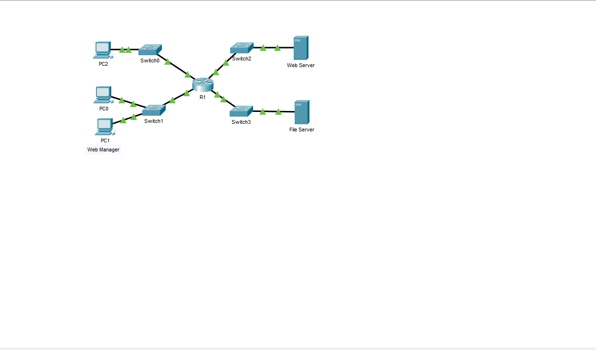
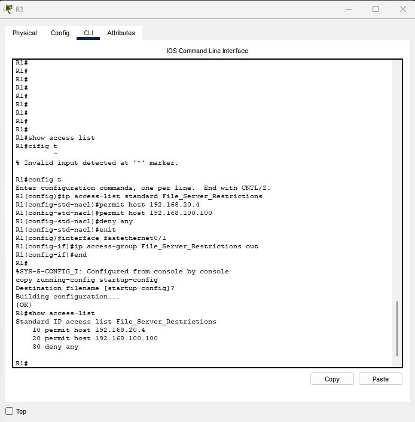
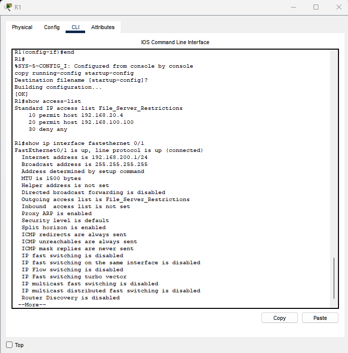
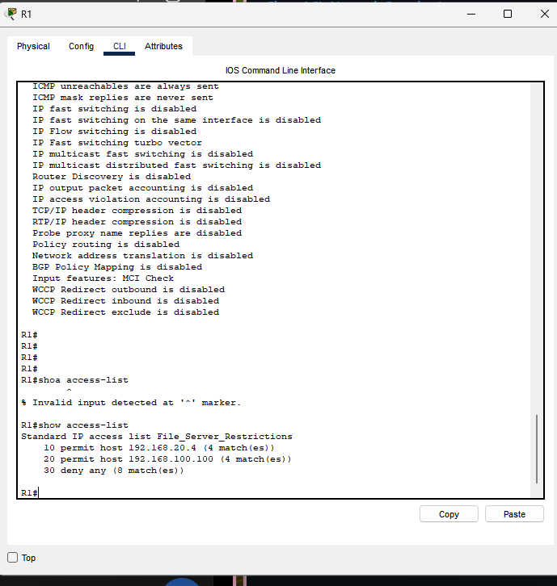
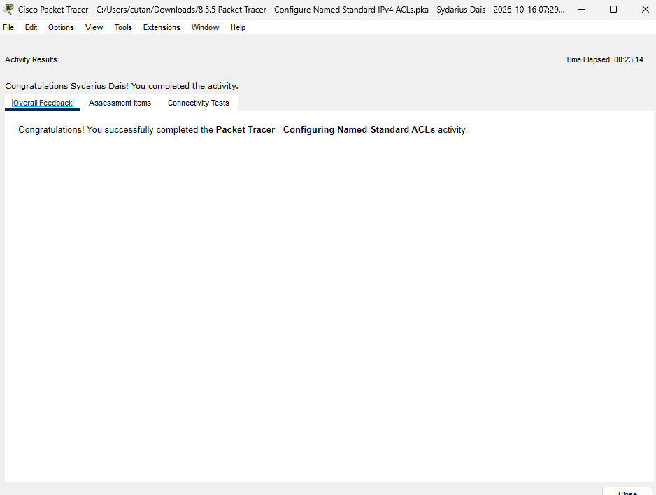

# Named Standard IPv4 ACL — File Server Access Control

## Project Overview

This Cisco Networking Academy Packet Tracer lab focused on configuring a named standard IPv4 Access Control List (ACL) to restrict access to a File Server.

The security objective was to permit authorized network devices while denying unauthorized access.

## Lab Environment

- Cisco Packet Tracer
- Cisco IOS CLI
- Router R1
- Three workstation PCs
- Web Server
- File Server

## ACL Configuration

The lab specified the following configuration:

```text
ip access-list standard File_Server_Restrictions
 permit host 192.168.20.4
 permit host 192.168.100.100
 deny any
```

The ACL was designed to permit traffic from PC1 and the Web Server while denying traffic from other source addresses.

## Verification

The completed lab worksheet recorded the following results:

- PC0, PC1, and PC2 could ping the Web Server.
- PC1 could access the File Server.
- The Web Server could access the File Server.
- PC0 and PC2 were blocked from accessing the File Server.

The saved assignment also references using `show access-lists` to inspect ACL entries.

## Technical Concepts

- Named standard IPv4 access control lists
- Source IP address filtering
- Permit and deny statements
- ACL rule ordering
- Router configuration and verification
- Network connectivity testing

## Lessons Learned

Standard IPv4 ACLs filter traffic based on source addresses. Understanding rule order and ACL placement is essential when implementing access restrictions.

This lab demonstrates concepts relevant to network security, access control, and troubleshooting.

## Evidence

The original lab screenshot and final router configuration will be reviewed before adding them as verified portfolio evidence.
## Lab Evidence and Screenshots

### 1. Network Topology
The lab topology includes router R1, four switches, three workstations, a Web Server, and a File Server.



### 2. Named ACL Configuration
The router was configured with the named standard ACL `File_Server_Restrictions`, containing two permit rules and one deny rule.



### 3. Interface Verification
The `show ip interface fastethernet 0/1` command verified that the named ACL was applied outbound on FastEthernet0/1.



### 4. ACL Match Counters
The `show access-lists` output recorded 4 matches for PC1, 4 matches for the Web Server, and 8 matches for the deny rule. These counters confirm that packets matched the rules, but do not independently establish the destination of each packet.



### 5. Packet Tracer Activity Completion
Cisco Packet Tracer confirmed successful completion of the named standard IPv4 ACL activity.



## Connectivity Test Results

| Source | Destination | Observed Result |
|---|---|---|
| PC0 (192.168.20.3) | File Server | 100% packet loss |
| PC1 (192.168.20.4) | File Server | 25% packet loss; 3 replies |
| PC2 (192.168.10.3) | File Server | Destination unreachable |
| Web Server (192.168.100.100) | File Server | 0% packet loss |

**Technical observation:** The ACL was applied outbound on FastEthernet0/1, as instructed in the lab. Because the File Server is connected through a different router interface, these observations alone do not establish that the ACL caused the failed File Server pings. Packet Tracer nonetheless reported successful activity completion.

## Attribution

Based on Cisco Networking Academy Packet Tracer Lab 8.5.5. This document is an original summary of the academic exercise and recorded results.
