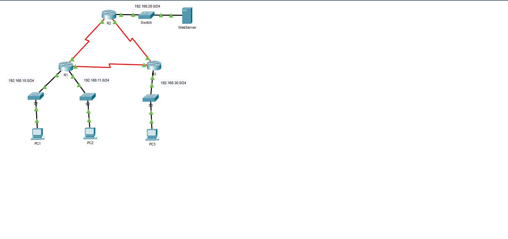
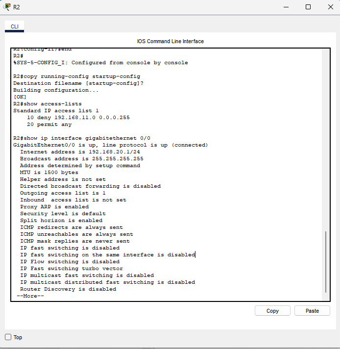
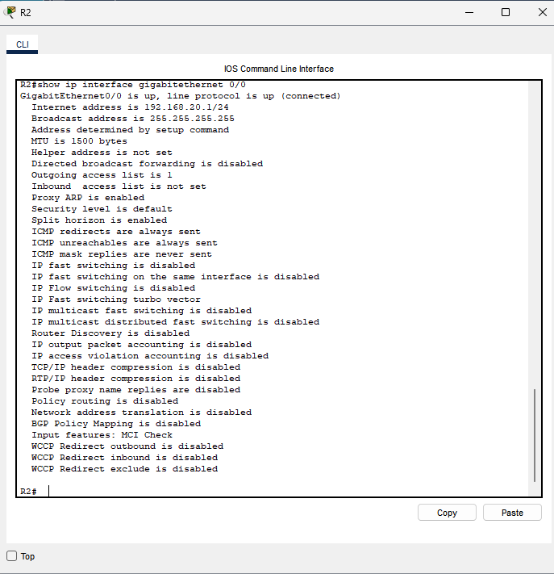
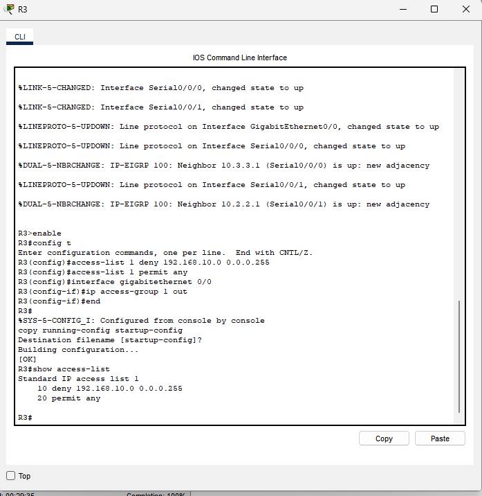
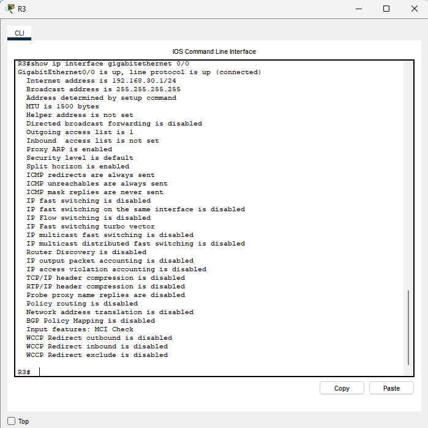
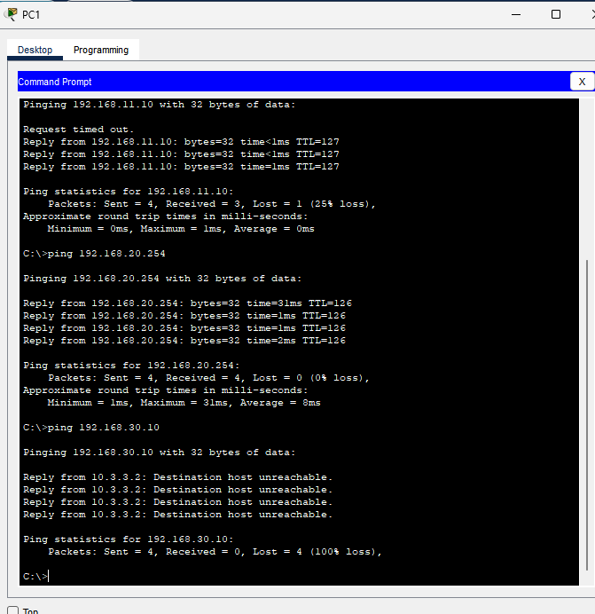
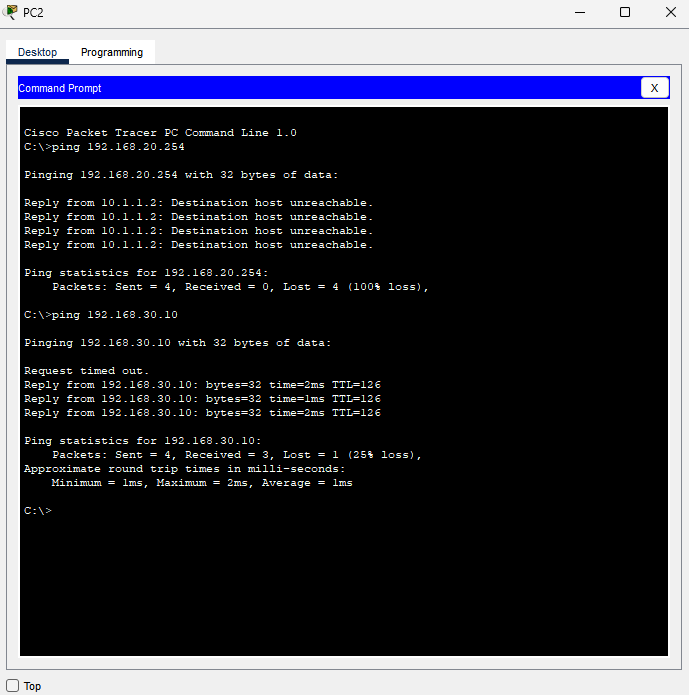
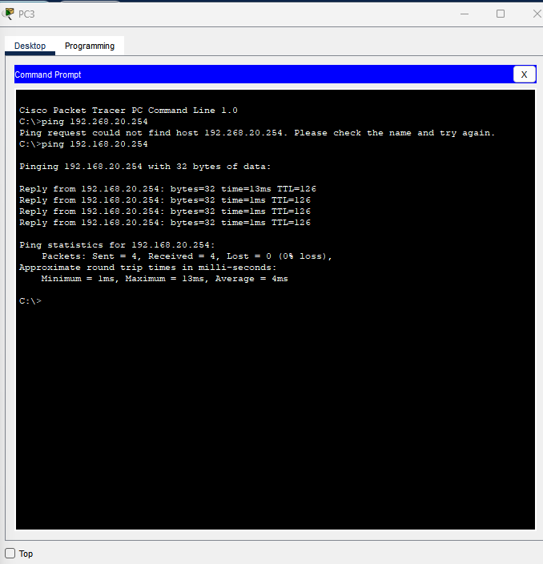
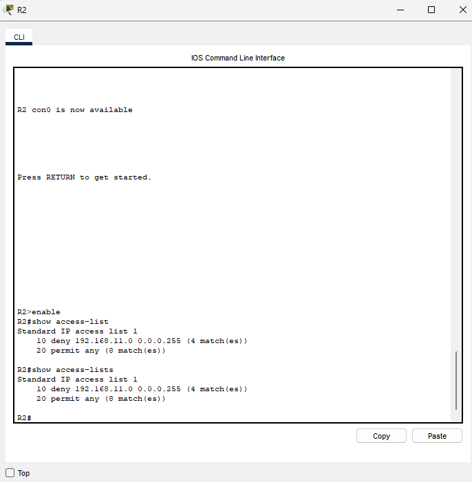
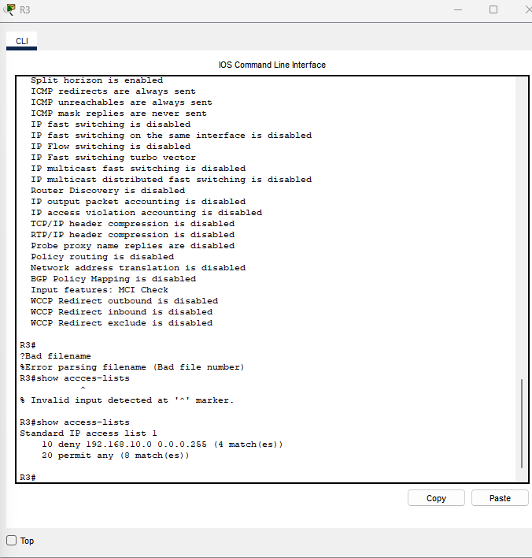

# Lab 8.5.6 — Numbered Standard IPv4 ACLs

**Category:** Cisco Networking / Network Security  
**Environment:** Cisco Packet Tracer (Cisco Networking Academy academic exercise)  
**Result:** Packet Tracer showed **100% completion** during R3 configuration; six connectivity tests were subsequently checked.

## Project objective

Configure numbered standard IPv4 access control lists (ACL 1) on two routers to implement source-address-based traffic restrictions while permitting other traffic. Verify that both ACLs are attached to the intended outgoing interfaces and validate the permitted/denied paths with ping tests and ACL match counters.

## Network overview

This lab uses three routed sites connected in a triangle, with R1 supporting two workstation networks, R2 connected to a Web Server network, and R3 connected to PC3. EIGRP routing was already configured as part of the lab environment.



| Device | IP address | Network |
|---|---|---|
| PC1 | `192.168.10.10` | `192.168.10.0/24` |
| PC2 | `192.168.11.10` | `192.168.11.0/24` |
| Web Server | `192.168.20.254` | `192.168.20.0/24` |
| PC3 | `192.168.30.10` | `192.168.30.0/24` |

## Policy 1 — R2: restrict PC2's network from the Web Server network

```cisco
access-list 1 deny 192.168.11.0 0.0.0.255
access-list 1 permit any
interface GigabitEthernet0/0
 ip access-group 1 out
```

These rules deny packets from `192.168.11.0/24` as they leave R2 through `G0/0` toward `192.168.20.0/24`, while allowing other source networks. This is a **standard** ACL: it matches source IP addresses, and the interface placement limits where the filtering applies.



R2's `show ip interface gigabitethernet 0/0` output confirmed that GigabitEthernet0/0 was up and **outgoing access list was 1**.



## Policy 2 — R3: restrict PC1's network from PC3's network

```cisco
access-list 1 deny 192.168.10.0 0.0.0.255
access-list 1 permit any
interface GigabitEthernet0/0
 ip access-group 1 out
```

The R3 ACL prevents packets originating from `192.168.10.0/24` from exiting R3's `G0/0` toward `192.168.30.0/24`, while allowing other sources.



R3's `show ip interface gigabitethernet 0/0` output confirmed that GigabitEthernet0/0 was up and **outgoing access list was 1**.



## Connectivity testing — observed results

Tests were run after applying the ACLs. Initial timeouts on otherwise permitted connections occurred in some cases, followed by successful replies.

| Source | Destination | Observed outcome | Policy expectation |
|---|---|---|---|
| PC1 | PC2 (`192.168.11.10`) | 3/4 replies; 25% loss | Allowed |
| PC1 | Web Server (`192.168.20.254`) | 4/4 replies on repeat; 0% loss | Allowed |
| PC1 | PC3 (`192.168.30.10`) | Destination host unreachable; 100% loss | Denied |
| PC2 | Web Server (`192.168.20.254`) | Destination host unreachable; 100% loss | Denied |
| PC2 | PC3 (`192.168.30.10`) | 3/4 replies; 25% loss | Allowed |
| PC3 | Web Server (`192.168.20.254`) | 4/4 replies; 0% loss | Allowed |

### PC1 — permitted and denied destinations



### PC2 — denied Web Server access, permitted PC3 access



### PC3 — permitted Web Server access



## ACL match counters

After testing, `show access-lists` reported:

| Router | Deny matches | Permit matches |
|---|---:|---:|
| R2 | 4 (`192.168.11.0/24`) | 8 |
| R3 | 4 (`192.168.10.0/24`) | 8 |





## Verification and lessons learned

- The ACL entries on R2 and R3 were checked using `show access-lists`.
- ACL placement was checked using `show ip interface gigabitethernet 0/0`.
- Running configurations were saved to startup configurations on both routers; their CLI outputs showed `[OK]`.
- All six tested source/destination paths behaved consistently with the intended access policies.
- Standard ACLs only identify traffic by **source address**, so their *placement* is crucial to applying policies to the intended destination network.

## Completion and evidence note

A Packet Tracer screen captured during R3 configuration displayed **Completion: 100%**. A separate **full-screen completion/Overall Feedback screenshot** suitable for the school assignment was not provided in this evidence set and is not claimed here. The images in this repository are recorded activity screenshots, not production network evidence.

## Attribution

An original project write-up of Cisco Networking Academy's **8.5.6 Packet Tracer — Configure Numbered Standard IPv4 ACLs** academic lab. The provided Packet Tracer activity and instructor worksheet are not redistributed in this repository.
