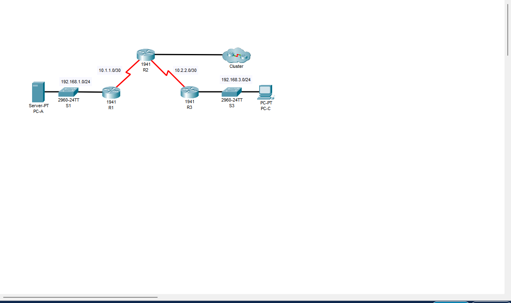
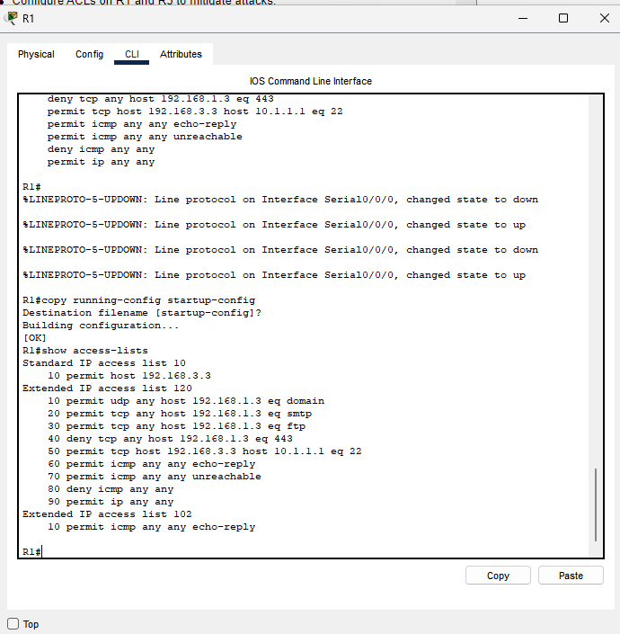
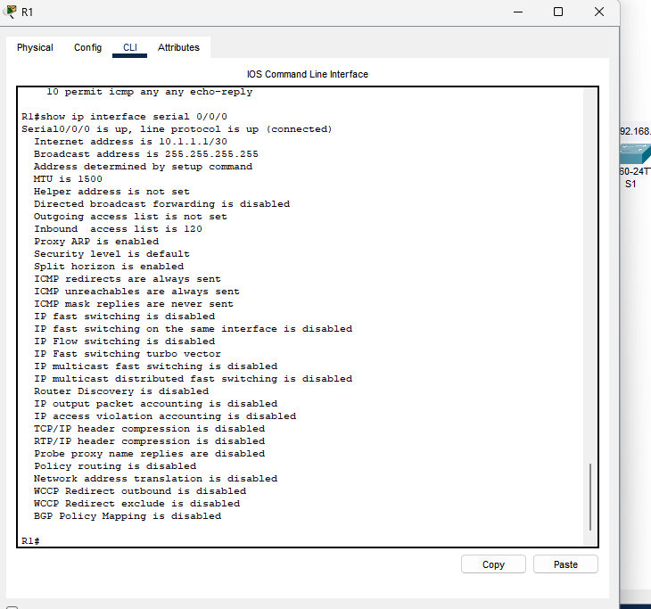
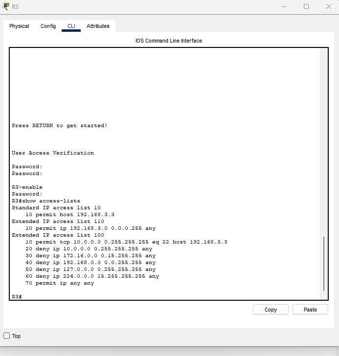
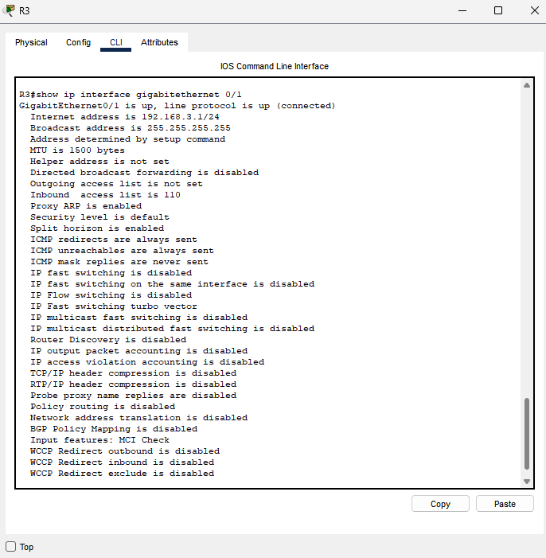
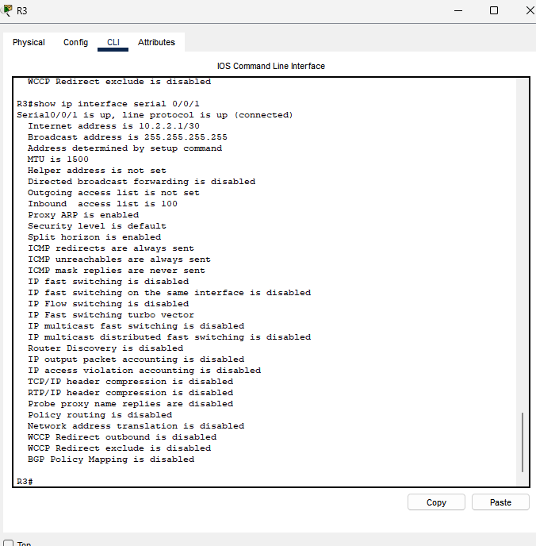
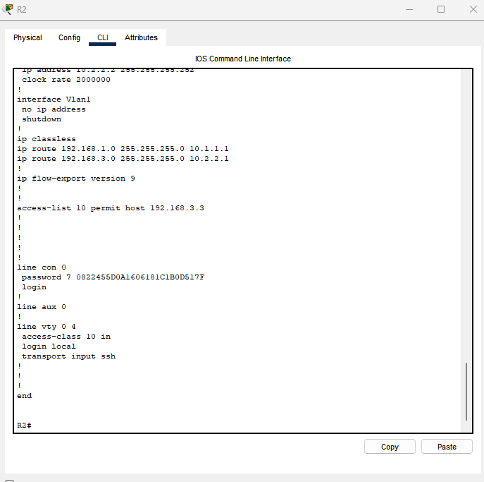
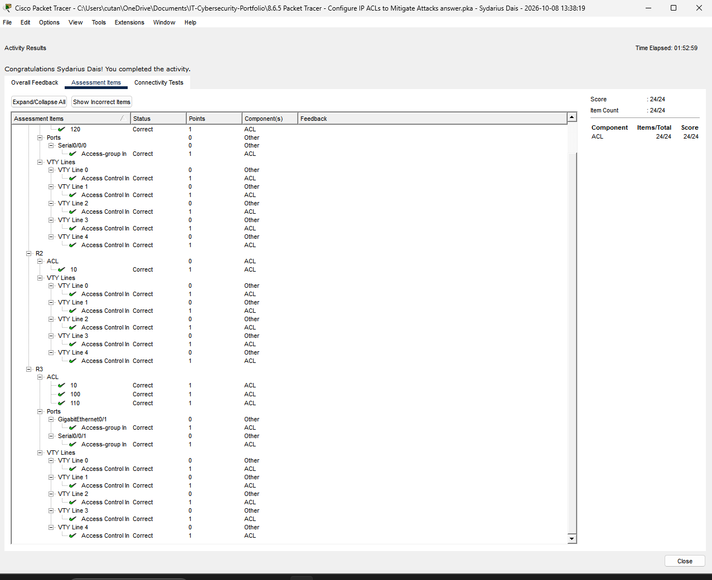

# Cisco Packet Tracer Lab 8.6.5 — IP ACLs to Mitigate Attacks

## Overview
Academic network security exercise using Cisco IOS access control lists (ACLs) on routers R1, R2, and R3. The task involved limiting SSH management to PC-C, applying service-specific filtering on R1, and filtering potentially spoofed source IP addresses on R3.

**Environment:** Cisco Packet Tracer, Cisco IOS, three routers (R1/R2/R3), switches S1/S3, server PC-A (`192.168.1.3`), management station PC-C (`192.168.3.3`).

**Assessment:** Packet Tracer reported successful activity completion and **24/24** assessment items after correcting ACL 120's rule order. This reports the activity's assessment result, not an independent penetration test.

## Lab topology


## Implemented access controls

| Device | ACL | Role and placement |
|---|---|---|
| R1, R2, R3 | Standard ACL 10 | Permits SSH management from `192.168.3.3`; applied inbound to VTY lines with `access-class 10 in` |
| R1 | Extended ACL 120 | Service-based ingress filtering; applied inbound to Serial0/0/0 |
| R3 | Extended ACL 110 | Permits sources from `192.168.3.0/24`; applied inbound to GigabitEthernet0/1 |
| R3 | Extended ACL 100 | Filters selected private, loopback, and multicast sources with a management SSH exception; applied inbound to Serial0/0/1 |

## R1 — Service-based security filtering

The observed ACL 120 configuration included rules to permit DNS (UDP/53), SMTP (TCP/25), and FTP (TCP/21) to PC-A; deny HTTPS (TCP/443) to PC-A; permit specified SSH management traffic; permit ICMP echo replies and destination-unreachable messages; deny other ICMP traffic; and permit remaining IP traffic. These permissions are specific to the provided lab scenario, not a general firewall policy recommendation.





## R3 — Network edge filtering

ACL 110 permits sources from the local `192.168.3.0/24` network. ACL 100 explicitly filters designated source address ranges on the serial edge interface while allowing an SSH exception to the management station.







## R2 — Management access restrictions

The observed running configuration contains `access-list 10 permit host 192.168.3.3`, `line vty 0 4`, `access-class 10 in`, `login local`, and `transport input ssh`. Together these settings restrict VTY logins to the management source allowed by ACL 10, using local authentication and SSH.



## Troubleshooting and validation

Packet Tracer initially reported **23/24** assessment items, with **R1 ACL 120** flagged as incorrect. Inspection of `show access-lists 120` identified an overly broad `permit icmp any any` entry. After removing the extra entry, the ACL's `permit ip any any` statement preceded `deny icmp any any`, which would prevent that deny rule from matching. The rule order was corrected to:

```text
permit icmp any any echo-reply
permit icmp any any unreachable
deny icmp any any
permit ip any any
```

On rechecking, Packet Tracer displayed **24/24** and a successful completion message. This is documented evidence of configuration assessment; individual connectivity/SSH test outputs have not been included in this portfolio package.



## Skills demonstrated
- Standard and extended Cisco IOS ACLs
- Restricting router management through VTY access classes
- Inbound interface ACL application and verification
- TCP/UDP/ICMP rule matching and first-match rule ordering
- Edge anti-spoofing policy concepts
- Troubleshooting a failed configuration assessment using CLI output

## Attribution
Based on Cisco Networking Academy Packet Tracer activity 8.6.5, *Configure IP ACLs to Mitigate Attacks*. This README is an original learning summary. The instructor's assignment and `.pka` assessment file are not included.
